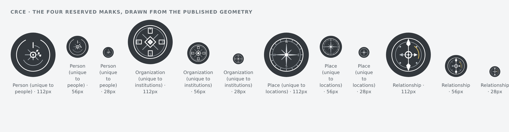
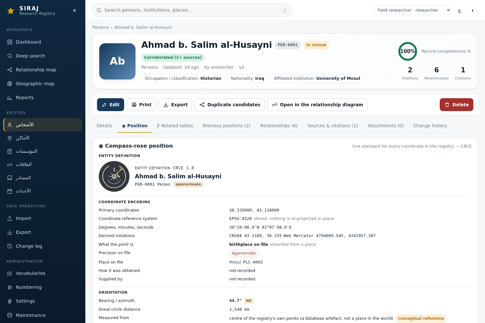
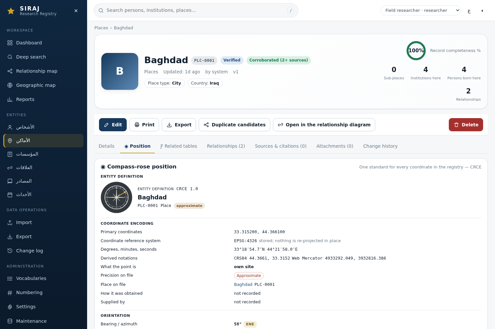
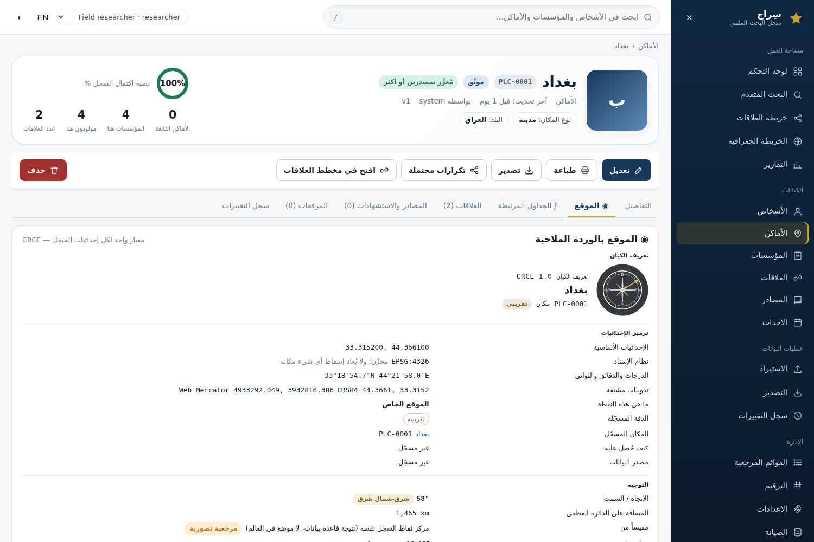
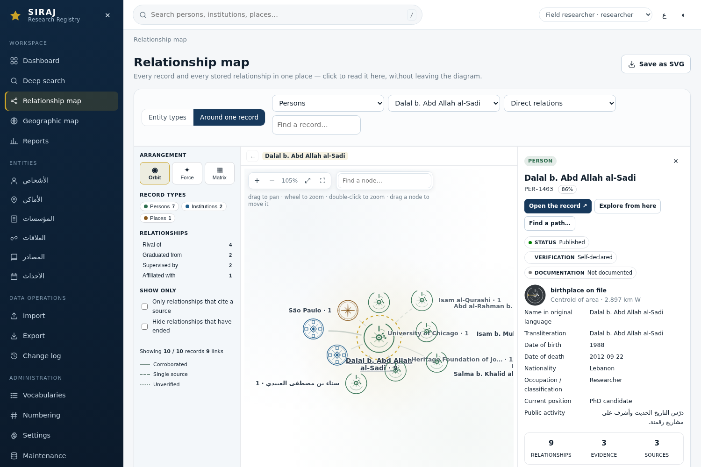
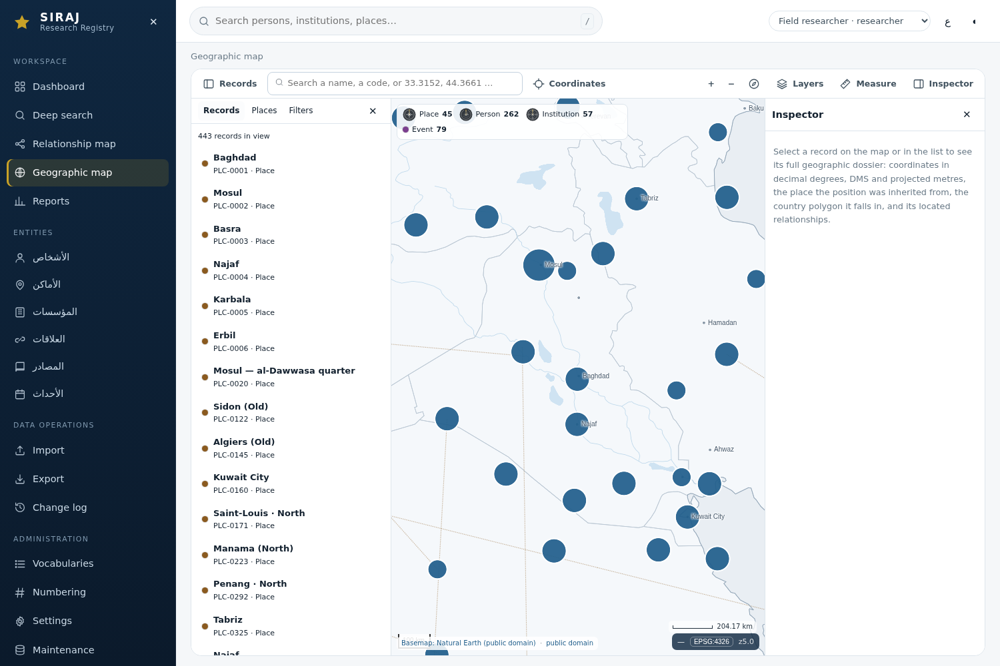

# CRCE — Compass-Rose Coordinate Encoding

*One encoding for every spatial reference in the registry, four marks that may
never be borrowed, and a written rule for every case where the registry does not
know where something is.*

---

## 1. Why a standard, and not a map pin

A biographical registry is full of positions, and almost none of them are the
same kind of thing. A place has a point because it was geolocated. A person has a
point because a birthplace is on file — which says where the record of their
birth is anchored, not where the person ever stood. An institution has a point
because a seat was recorded, which is not the same as where it operated. A
relationship has no point at all; it has two ends and, if the sources support
it, a direction between them. An event has a place and a date and no claim to
either of the four marks.

Displaying all of that with one blue pin is a lie of uniformity: it makes a
centroid-of-area, an inherited birthplace and a verified street address look
identical. The alternative is not four different widgets either, because then
nothing is comparable.

**CRCE** is the third option: a single encoding, with a fixed vocabulary of
roles, precisions and marks, that makes each of those cases *recognisably
different while drawing them the same way*.

The standard is implemented as code, not as a PDF:
[`app/crce.py`](../app/crce.py) holds the version, the rules, the vocabularies
and the geometry; [`app/server/crce_api.py`](../app/server/crce_api.py) serves
it; [`app/static/js/components/crce.js`](../app/static/js/components/crce.js)
is the single interpreter that draws it. There is one implementation, and every
surface uses it.

---

## 2. What the standard says

`GET /api/crce/standard` returns the whole standard. Its shape is the standard:

| field | meaning |
|---|---|
| `standard.id`, `standard.version` | `CRCE`, `1.0` — a version you can cite and diff |
| `standard.name_en` / `name_ar`, `summary_en` / `summary_ar` | the name and the promise, in both working languages |
| `standard.storage_crs` | `EPSG:4326` — what coordinates are stored in |
| `standard.reserved` | `person`, `organization`, `place`, `relationship` — the four categories that own a mark |
| `standard.uncovered` | `event`, `source` — kinds the standard does **not** dress |
| `symbols` | the four marks, with their geometry, labels and meanings |
| `categories` | how registry record kinds map onto the standard's vocabulary |
| `roles` | the closed list of what a coordinate may be: `site`, `birthplace`, `seat`, `event_place` |
| `rules` | the seven rules, each with an English and an Arabic sentence |

### 2.1 The rules, in the order they matter

| code | rule |
|---|---|
| `no_invention` | Coordinates are never invented, inferred or interpolated. A record with no georeferenced place has no fix, and says so. |
| `preserve_original` | The value on file is reported unchanged, with its reference system; every other notation (DMS, CRS84, Web Mercator) is derived from it and labelled as derived. |
| `person_not_pin` | A person's point is inherited from a place on file. It is not a measured position and never represents the person's whereabouts. |
| `seat_not_operations` | An institution's point is its recorded seat, not its operational footprint. |
| `direction_needs_two` | A bearing is drawn only between two real, located points. No reference point, no needle. |
| `exclusive_symbols` | Each category's mark belongs to that category alone and is reused for nothing else. |
| `not_covered` | A kind the standard does not cover borrows no mark; its coordinates are still read, and the dossier says why the rose is empty. |

The last two are the ones that need machinery rather than prose, and they are
covered in §4 and §7.

---

## 3. The dossier — the published field order

Every spatial reference, of every covered kind, is described in the same order:

```
1  Entity definition        what this is: name, code, category, mark
2  Coordinate encoding      the point, its CRS, its notations, its precision, its provenance
3  Orientation              bearing / azimuth, sixteen-point name, distance, the reference it is measured from
4  Relative position        what contains it, what it sits within
5  Compass rose representation   which mark, in which state, with which parts
6  Relationship mapping     every neighbour that has a fix, and the direction to it
7  Notes on accuracy        what the reader must know before using any of it
```

`GET /api/crce/dossier/{entity_type}/{record_id}` returns exactly those
sections, as data. Nothing is formatted for one screen; the surfaces decide how
to draw it. Two conveniences exist on the route and nothing more:

* the standard's own vocabulary is accepted as an alias — `organization` and
  `organisation` resolve to the registry's `institution`, `people` to `person`,
  `location` to `place`;
* an unknown category, or a missing record, is a `404`. A dossier is never
  built out of guesses.

### 3.1 Coordinate encoding

```
primary        lat, lon, axis ("lat,lon"), unit ("degree"), crs ("EPSG:4326")
formats        decimal_degrees · dms · crs84 (lon, lat) · web_mercator (m)
               + geohash_note_en / _ar: "the notations above are derived"
precision      code, status, label — from the record's own geo_precision lookup
uncertainty_m  the radius on file, if any
method         how the point was obtained
source         who supplied the geometry
role           site | birthplace | seat | event_place, with its bilingual sentence
place          the place the point actually belongs to (code, name, route)
inherited      true when this record did not measure the point itself
```

The single most important line here is `inherited`. A person's dossier reports
`role: birthplace` and `inherited: true` because the coordinate belongs to the
place row, not to the person. The place's own dossier reports
`role: site`, `inherited: false`.

### 3.2 Orientation, and the honest reference point

A bearing without a stated origin is a number pretending to be information. So
the orientation block always names its reference:

1. the **enclosing place** of the point (walk up the place hierarchy to the
   first ancestor with a fix) — a real feature of the world; or, failing that,
2. the **centre of the registry's own points**, which is a database artefact and
   is labelled as such, in the data (`reference.conceptual = true`) and on the
   screen (`conceptual reference` badge), with a note in the dossier.

The sixteen-point name (`N`, `NNE`, `NE`, … `W`, `WNW`) is given in both
languages, and the phrase (`2,897 km W`) is generated from the same numbers that
are printed beside it — never written by hand.

### 3.3 Notes on accuracy

Notes are not warnings bolted on; they are the part of the standard that keeps
the rest honest. The codes in use:

| code | level | when |
|---|---|---|
| `inherited` | info | the point belongs to a place on file, not to this record |
| `person_not_pin` | info | the record is a person: location ≠ identity |
| `seat_not_operations` | info | an institution: registered seat ≠ where it operated |
| `precision` | warn | the point is approximate, a centroid, or uncertain |
| `conceptual_reference` | warn | the bearing is measured from the registry centre |
| `no_source` | warn | no provenance is recorded for the coordinate |
| `no_fix` | warn | nothing is georeferenced: no coordinates, no needle |
| `direction_unknown` | warn | a relationship with an unlocated end |
| `coincident_ends` | info | both ends resolve to the same point: no azimuth exists |
| `connect_not_claim` | info | a connection is not a finding of responsibility |
| `not_covered` | info | this record kind may not wear a reserved mark |

---

## 4. The four marks

Each mark lives in a 100 × 100 box, is drawn from cartographic primitives
(`ring`, `arc`, `line`, `poly`, `dot`, `text`), and is published by the API so
that no surface can invent a fifth one. All four share the same field: a
charcoal disc (`#33383d`), white ink (`#ffffff`), light-grey secondary
(`#b9c0c7`), a single warm accent (`#e3c05a`) reserved for the directional
reading, and a distinct centre point.

| id | category | the mark |
|---|---|---|
| `crce-person` | person | An **open** ring (a deliberate north gap), a hollow core, one long heading, a three-dot track, and a second broken ring at r = 30 for legibility when small. A person is a heading, not a monument. |
| `crce-organization` | organization | Four chambers around a diamond seat: an institution is a seat with departments around it, not a pin. |
| `crce-place` | place | The full instrument: an eight-point star, two rings, sixteen graduations, and `N` `E` `S` `W` lettered inside the ring. A place is the only mark that is a compass. |
| `crce-relationship` | relationship | A ringed core with a double-ended needle and a swept accent arc: direction without a fixed centre. |



*The four marks as the application draws them, from the published geometry — at
the size a record page shows, the size a marker shows, and the size a dense atlas
node gets.*

**Exclusivity is structural, not stylistic.** `SYMBOLS` is keyed by category,
`CATEGORY_OF` maps record kinds onto it (`institution → organization`), and a
record kind that is not in `CATEGORY_OF` gets `symbol: null` — it cannot borrow
one, because there is no code path that hands it a symbol. The marks are not
interchangeable decoration; the person mark is the *only* thing a person can
wear, and the place mark appears nowhere a person or an organization is drawn.

### 4.1 The needle is not the mark

An earlier draft rotated the whole mark to show the bearing. That is wrong: a
compass rose that turns has no north. The mark is drawn upright, always, and the
bearing is drawn **on top of it** as a separate accent needle:

```
svgString(id, size, { needle: true, rotation: 270.9 })   →  upright rose + accent needle at 270.9°
```

`rose.needle` is `false` whenever no bearing exists, so an unlocated record
renders a mark with no needle at all rather than a needle pointing at nothing.

---

## 5. The inheritance model

```
place        lat/lon on the row                    → role: site          inherited: false
 └ person    birthplace_id → that place's point    → role: birthplace    inherited: true
 └ institution  place_id → that place's point      → role: seat          inherited: true
 └ event     place_id → that place's point         → role: event_place   inherited: true
```

If the referenced place exists but has **no** coordinates, the record has **no
fix**. It does not get the country centroid, the province centre, or an
interpolated point. This is the difference between a database that is honest and
one that is merely complete-looking, and it is why `status: unlocated` is a
first-class state on the dossier rather than an absence.

Two further distinctions survive into the interface:

* **registered address vs operational location.** An institution's mark is its
  recorded *seat*; the wording says so, and the note says so.
* **a person's location vs a person's identity.** A person is drawn with the
  person mark and a birthplace, and the dossier carries the `person_not_pin`
  note in both languages — the visual cannot be mistaken for a tracking device.

---

## 6. Relationships

A relationship has no coordinate of its own. Its dossier carries `ends[2]`,
each with its own category's mark, its own role, and its own fix (or its
absence). Three states are possible, and each is distinguishable on screen:

| status | when | the drawing |
|---|---|---|
| `located` | both ends have a fix and they are not the same point | rose + needle at the bearing between the ends |
| `same_point` | both ends resolve to the same recorded point | rose, **no needle**, note `coincident_ends` — a zero-length vector has no azimuth |
| `unlocated` | at least one end has no fix | rose, no needle, note `direction_unknown` |

The relationship's own mark (`crce-relationship`) is used for the connection
itself; the ends carry `crce-person`, `crce-organization` or `crce-place`.
`connect_not_claim` is always present: a connection is not a finding of
responsibility.

---

## 7. What the standard does not cover

`event` and `source` are declared in `standard.uncovered`. A dossier can still
be requested for them — the coordinate work is the same, and a date and a place
should be readable the same way — but:

* `entity.symbol` is `null`, `entity.covered_by_standard` is `false`;
* `rose.symbol` is `null`: the rose is left empty rather than filled with
  another category's mark;
* the dossier carries the `not_covered` note explaining why.

In the interface this surfaces as a chart of the coordinates with no mark, plus
the sentence that says the standard does not dress this kind. Nothing is dressed
up as something it is not.

---

## 8. Where the standard appears

| surface | how CRCE appears |
|---|---|
| **Record page → Position tab** | The whole dossier, in the published field order, in Arabic or English, with the mark, the accuracy notes and the relationship mapping. The tab exists on every record; uncovered kinds render the not-covered state. |
| **Atlas (relationship map)** | Each covered node is drawn *as its mark* — the rosette is the node, not a badge on it. The connection count moves into the label (`Persons · 6.8k`) so it cannot cover the geometry. A selected record shows a position tile in the panel: mark, role, precision, and the phrase (`recorded seat · Uncertain · 3,937 km ENE`). |
| **Geographic map** | A dedicated `geo-crce` symbol layer (min zoom 6.5) draws the three geographic categories as their marks over the plain dots; click hit-testing includes it; the legend shows the reserved mark per category rather than a coloured dot. |
| **Export** | `app.crce.svg(category, size)` and `sprite()` render the same geometry for documentation and for the saved SVG of the atlas. |



*The Position tab: the mark, the inherited birthplace, the reference the bearing
is measured from, the neighbours with their own directions, and the notes that
say what the point is and is not.*

| | |
|---|---|
|  |  |
| a place: its own site, DMS and CRS84 alongside the stored value, sixteen graduations and the cardinal letters | the same dossier in Arabic, right-to-left, with the mark unchanged |
|  |  |
| the atlas: each covered node drawn as its own mark, the count in the label, the position tile in the panel | the geographic map: the reserved marks in the legend, and the symbol layer over the dots |

The client interpreter (`A.crce`) is the only place that turns geometry into
pixels:

```js
A.crce.standard()                       // fetch + cache the standard
A.crce.symbol("place")                  // one symbol's record
A.crce.svgString("place", 48, {needle: true, rotation: 58})
A.crce.attach(host, dossier, {size})    // draw a dossier's own mark into the DOM
A.crce.panel(dossier)                   // the full field-ordered dossier, AR/EN
A.crce.iconImage("person", 44)          // canvas icon, for MapLibre
A.crce.iconDataUrl("place", 24)
A.crce.registerMapIcons(map, 44)        // register all three with a MapLibre map
```

---

## 9. Verification

The standard is proved by executed tests, not by this document:

* `tests/crce_ui.py` — **93 checks** in a browser and over HTTP: the published
  standard, exclusivity, a place's encoding, a person's inheritance, an
  unlocated record, three relationship states, aliases and 404s, the Position
  tab in both languages and both directions, the atlas rosettes and the panel
  tile, and the geographic legend.
* `tests/verify_all.py --only crce` — **33 checks** on the API surface, inside
  the route inventory, so the two CRCE routes cannot go untested.
* `python3 scripts/check.py --crce` runs the browser suite as part of the
  pre-flight check.

---

## 10. Extending it

* **Another language.** Every string in a dossier carries `_en` and `_ar`, and
  the client picks by `App.state.lang`. Adding a locale means adding a third
  variant next to the two that exist — no per-screen translation table.
* **Another record kind.** Add it to `CATEGORY_OF` only if one of the four marks
  genuinely describes it. If none does, add it to `standard.uncovered` and write
  the sentence that explains why — the standard is a claim about meaning, and an
  extra category is a change to the claim, not a config toggle.
* **Another notation.** A new coordinate format belongs in `_formats()` beside
  the existing ones, derived from the stored value, and labelled as derived.
  Nothing writes back to the stored pair.
