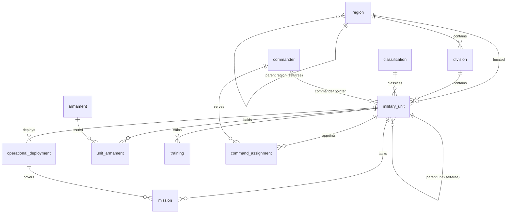

# Military Organization — Brigade Information Management System (BIMS)

> **FICTIONAL DATA NOTICE** — every person, unit, place, deployment, operation and
> country name in this module's sample dataset is **invented for demonstration**
> and does not depict any real military organization, operation or person. The
> module stores ordinary business information only; it contains no classified or
> operational content.

The Military Organization module is a self-contained **Brigade Information
Management System** integrated into researchers-db. It keeps its own SQLite
database, its own router and its own interface, and shares the house with SIRAJ
without touching the registry, its routes, or its locale catalogues.

| Aspect | Where it lives |
| --- | --- |
| Database | `military.db` in the project data directory (`SIRAJ_MILITARY_DB` overrides) — **never** `registry.db` |
| Schema, connection rules | `app/military/dbm.py` |
| Controlled vocabularies | `app/military/vocab.py` |
| Naming series engine | `app/military/naming.py` |
| Rule catalogue | `app/military/rules.py` |
| Transactional service layer | `app/military/service.py` |
| HTTP API | `app/military/api.py`, mounted at `/api/military` |
| Fictional sample dataset | `app/military/seed.py` |
| CLI verification | `app/military/cli.py` (`python -m app.military.cli verify`) |
| Interface | `app/military/ui/`, served at `/military/` |
| Tests | `tests/test_military.py` |

Companion documents: [DATA_MODEL](DATA_MODEL.md) (SIRAJ registry),
[API](API.md) (SIRAJ endpoints), [OPERATIONS](OPERATIONS.md) (deployment &
security), [UI_GUIDE](UI_GUIDE.md) (SIRAJ shell), [VERIFICATION](VERIFICATION.md)
(evidence standards). This document describes **exactly** what the code
implements; where the design record leaves policy open, the implemented choice
is stated explicitly.

---

## 1. What the system does

1. Records the organisation of a military force: **regions, divisions,
   classifications, commanders, and a hierarchy of military units**.
2. Records what those units do: **operational deployments, missions, training**,
   and the **armament** they hold.
3. Records who commands: **command appointments** over time, with exactly one
   current appointment per unit and role.
4. Attaches **notes** to any of the above.
5. Enforces the business rules of the design record **server-side**, on every
   write, in a single transaction per request.
6. Assigns every record an **automatically generated document name** from a
   configurable naming series — users never type system identifiers.
7. Audits every mutation with actor, timestamp and field diff.

---

## 2. Entity–relationship overview

Twelve entity types. `id` is a generated surrogate key; `docname` is the
generated, immutable document name (naming series); `created_at/created_by/
modified_at/modified_by` are system-maintained on every table (audit metadata,
§12.3).



Notes (`note`) link polymorphically to any allowlisted target type
(`unit`, `deployment`, `mission`, `training`, `assignment`, `commander`,
`armament`, `region`, `division`) — validated to exist at write time.

**Pointer fields** (synchronised, never hand-edited):

| Field | Meaning | Sync rule |
| --- | --- | --- |
| `military_unit.current_deployment_id` | the unit's current deployment | mirrors `operational_deployment.is_current = 1` for the unit (newest wins); cleared when the flag clears or the deployment is deleted |
| `military_unit.commander_id` | the unit's commander | mirrors the current `Commanding Officer` appointment; cleared when it ends or is deleted |

---

## 3. Data dictionary

Legend: **R** = required on create, **U** = unique, choices are enumerated in
`app/military/vocab.py` (owner-reviewable data). Dates are ISO `YYYY-MM-DD`.
`docname` and audit columns exist on every table but are shown once.

### 3.1 Region (self-tree)

| Field | Type | Notes |
| --- | --- | --- |
| `name` | text | R |
| `region_type` | choice | `Theater · Region · Zone · Area` (default `Region`) |
| `parent_id` | → region | self-tree parent (root when empty) |
| `country` | text | |
| `description` | text | |
| `path`, `depth` | system | materialised tree path (`/id/id/`) and depth — maintained by the service layer |

### 3.2 Division

| Field | Type | Notes |
| --- | --- | --- |
| `name` | text | R |
| `region_id` | → region | R |
| `division_type` | choice | `Mechanized · Armored · Infantry · Artillery · Support · Airborne` |
| `formation_date` | date | |
| `headquarters` | text | |
| `description` | text | |

### 3.3 Classification

| Field | Type | Notes |
| --- | --- | --- |
| `name` | text | R, U |
| `category` | choice | `Combat · Support · Reserve · Training` |
| `readiness_tier` | choice | `High · Medium · Low` |
| `description` | text | |

### 3.4 Commander

| Field | Type | Notes |
| --- | --- | --- |
| `full_name` | text | R |
| `rank_title` | choice | `General · Brigadier General · Colonel · Lieutenant Colonel · Major · Captain · Lieutenant` |
| `branch` | choice | `Army · Air Force · Navy · Joint` |
| `commission_date` | date | |
| `status` | choice | `Active · Reserve · Retired` (default `Active`) |
| `biography` | text | |

### 3.5 Military Unit (self-tree)

| Field | Type | Notes |
| --- | --- | --- |
| `name` | text | R |
| `code` | text | U — optional meaningful business code (never generated) |
| `echelon` | choice | `Brigade · Division · Regiment · Battalion · Company · Platoon · Squadron · Detachment` (default `Brigade`) |
| `parent_id` | → unit | self-tree parent |
| `classification_id` | → classification | |
| `division_id` | → division | |
| `region_id` | → region | |
| `commander_id` | → commander | **pointer** — synced from the current CO appointment |
| `role` | text | |
| `status` | choice | `Active · Training · Standby · Mobilized · Attached · Reserve · Reorganizing · Stand-down · Disbanded` (default `Active`) |
| `direct_personnel` | int ≥ 0 | **locally maintained** strength assigned directly to this unit |
| `current_deployment_id` | → deployment | **pointer** — synced from `is_current` |
| `formation_date` | date | |
| `headquarters` | text | |
| `notes` | text | |
| `path`, `depth` | system | materialised tree path |

**Subtree personnel** is `SUM(direct_personnel)` over the unit and all of its
descendants — computed from locally maintained `direct_personnel`, never entered
by users (see [UI-8](#8-interface)). The API exposes it as `subtree_personnel`.

### 3.6 Operational Deployment

| Field | Type | Notes |
| --- | --- | --- |
| `name` | text | R |
| `unit_id` | → unit | R |
| `deployment_type` | choice | `Operational · Training · Humanitarian · Peacekeeping · Reserve` |
| `start_date` | date | R |
| `end_date` | date | required when status is `Completed` |
| `status` | choice | `Planned · Active · Completed · Suspended` (default `Planned`) |
| `is_current` | bool | at most one current deployment per unit |
| `location`, `area_of_operations`, `notes` | text | |

### 3.7 Mission

| Field | Type | Notes |
| --- | --- | --- |
| `name` | text | R |
| `unit_id` | → unit | R |
| `mission_type` | choice | `Combat · Reconnaissance · Logistics · Training · Humanitarian · Peacekeeping` |
| `deployment_id` | → deployment | must belong to the same unit or to an **ancestor** unit |
| `start_date` | date | R |
| `end_date` | date | required when status is `Executed` |
| `status` | choice | `Planned · Ongoing · Executed · Cancelled` (default `Planned`) |
| `area`, `description`, `notes` | text | |

### 3.8 Armament

| Field | Type | Notes |
| --- | --- | --- |
| `name` | text | R |
| `category` | choice | `Weapons · Vehicles · Artillery · Aircraft · Communications · Support` |
| `specification`, `origin_country`, `description` | text | |

### 3.9 Unit Armament (bridge)

| Field | Type | Notes |
| --- | --- | --- |
| `unit_id` | → unit | R |
| `armament_id` | → armament | R — **U with `unit_id`** (a unit holds each armament at most once) |
| `quantity` | int | R, must be > 0 |
| `condition` | choice | `Serviceable · Limited · Unserviceable · In Refit` (default `Serviceable`) |
| `acquisition_year` | int | |
| `notes` | text | |

### 3.10 Training

| Field | Type | Notes |
| --- | --- | --- |
| `exercise_name` | text | R |
| `unit_id` | → unit | R |
| `training_type` | choice | `Exercise · Course · Certification · Drill · Joint Exercise` |
| `start_date`, `end_date` | date | R / R |
| `duration_days` | int ≥ 1 | R — must equal the inclusive date span |
| `participant_count` | int ≥ 0 | R — must not exceed the unit's subtree personnel |
| `lead_trainer` | text | |
| `assessment` | choice | `Excellent · Satisfactory · Needs Improvement · Unsatisfactory` |
| `location`, `notes` | text | |

### 3.11 Command Assignment

| Field | Type | Notes |
| --- | --- | --- |
| `unit_id` | → unit | R |
| `commander_id` | → commander | R |
| `role` | choice | `Commanding Officer · Deputy Commander · Chief of Staff · Acting Commander` (default `Commanding Officer`) |
| `assigned_date` | date | R |
| `relieved_date` | date | empty = ongoing |
| `is_current` | bool | at most one current appointment per (unit, role) |
| `notes` | text | |

### 3.12 Note

| Field | Type | Notes |
| --- | --- | --- |
| `entity_type` | choice | allowlisted target type (see §2) |
| `target_id` | int | R — target must exist |
| `note_text` | text | R |
| `author` | text | R |
| `note_at` | date | |

### 3.13 System-maintained columns (all tables)

| Column | Rule |
| --- | --- |
| `id` | generated surrogate key — never accepted from clients |
| `docname` | generated by the naming series — immutable, never accepted from clients |
| `created_at`, `created_by` | stamped at create |
| `modified_at`, `modified_by` | stamped at update |
| `path`, `depth` | tree tables only — maintained by the service layer |

Writes containing any system column are rejected with
`field_not_editable` (422).

---

## 4. Business rule catalogue

Every rule is implemented in `app/military/rules.py` (plus two service-level
hooks noted below) and evaluated **inside the request's transaction** against
the in-flight state. Violations return a structured error:
`{"ok": false, "error": {"code", "message", "field?"}}`.

| # | Rule | Code(s) | HTTP |
| --- | --- | --- | --- |
| 4.1 | **Date policy** — ISO format; end never earlier than start | `invalid_date`, `date_order` | 422 |
| 4.2 | **Tree integrity** — no self-parent, no cycles, parent must exist; `path`/`depth` rebuilt on re-parent (subtree re-rooted) | `tree_self_parent`, `tree_cycle`, `tree_missing_parent` | 422 |
| 4.3 | **Deployment consistency** — dates (4.1); `Completed` requires `end_date`; unit must exist | `completed_needs_end`, `unit_not_found` | 422 |
| 4.4 | **One current deployment** — at most one `is_current` deployment per unit; the unit pointer mirrors it and is cleared on unflag/delete | `one_current_deployment` | 409 |
| 4.5 | **Mission consistency** — dates; `Executed` requires `end_date`; a linked deployment's unit must be the mission's unit or an **ancestor** of it (a parent formation's deployment covers subordinate missions) | `executed_needs_end`, `mission_deployment_mismatch`, `deployment_not_found` | 422 |
| 4.6 | **Appointment overlap** — for the same (unit, role) two appointment windows may not overlap; an empty `relieved_date` counts as ongoing; `assigned_date` required | `appointment_overlap`, `assigned_date_required` | 409 / 422 |
| 4.7 | **One current appointment** — at most one `is_current` appointment per (unit, role); the commander pointer mirrors the current `Commanding Officer` and is cleared when it ends | `one_current_appointment` (service hook) | 409 |
| 4.8 | **Commander lifecycle** — `Active → Reserve → Retired` (Reserve may return to Active); `Retired` is terminal; a commander holding a current appointment cannot retire | `status_transition`, `unresolved_appointment` | 422 |
| 4.9 | **Training capacity** — `participant_count` ≤ subtree personnel (2, §3.5); `duration_days` must equal the inclusive date span | `participant_over_capacity`, `duration_mismatch` | 422 |
| 4.10 | **Holdings quantity** — quantity > 0; condition in vocabulary; one row per (unit, armament) | `quantity_positive`, `condition_choice`, `duplicate_holding` (service hook) | 422 |
| 4.11 | **Note targets** — `entity_type` in the allowlist; target must exist | `note_target_type`, `note_target_missing` | 422 |
| 4.12 | **Lifecycle transitions** — deployment `Planned → Active/ Suspended`, `Active → Completed/ Suspended`, `Suspended → Active/ Completed`, `Completed` terminal; mission `Planned → Ongoing/ Cancelled`, `Ongoing → Executed/ Cancelled`, terminal states final | `status_transition` | 422 |
| 4.13 | **Deletion policy** — deleting a record referenced by dependents is blocked with a dependent count (RESTRICT at DB level as second line); a deleted current deployment/appointment always clears its pointer | `delete_blocked` | 409 |
| 4.14 | **Role policy** — see §6; every write is checked server-side | `forbidden` | 403 |

Unit status changes are set-valued only (all nine values always allowed): the
unit transition policy is owner-reviewable and deliberately not hard-coded.

---

## 5. Automatic naming series

Implemented in `app/military/naming.py`; the catalogue is **data** (table
`naming_series_option`), seeded with the design record's Appendix B options.

### 5.1 Grammar

```
BODY[#+]
```

* BODY may contain the tokens `.YYYY.` (partition by creation year) and
  `.{field}.` (partition by a resolved field value, e.g. armament category).
* A token consumes its dots; a literal dot directly before the counter is a
  counter-slot marker and is dropped. Every catalogued label therefore renders
  as a clean identifier.
* A trailing run of `#` sets the counter width (default 5, zero-padded).

| Label | Renders as |
| --- | --- |
| `MIL-REG-` | `MIL-REG-00001` |
| `MIL-DEP-.YYYY.-` | `MIL-DEP-2026-00001` |
| `MIL-ARM-.{category}.#####` | `MIL-ARM-WEAPONS00001` |
| `MIL-TRN-.######` | `MIL-TRN-000001` |

### 5.2 Counter semantics

* Counters are keyed by **(series option, partition)**; year tokens and category
  segments partition the sequence (`2026`, `WEAPONS`, `2026|WEAPONS`, …).
* `POST /api/military/naming/preview` is **advisory** — it never reserves its
  value (concurrent inserts may advance the counter first).
* Creating a record reserves the next value transactionally (`next_name`).
* Adjusting a counter is **admin-only** and written to
  `naming_adjustment_log` (old/new value, actor, timestamp) plus the audit log.

### 5.3 Catalogue (19 options)

| Entity | Options (★ = default) |
| --- | --- |
| Region | ★`MIL-REG-` |
| Division | ★`MIL-DIV-` |
| Classification | ★`MIL-CLS-` |
| Commander | ★`MIL-CMD-` |
| Military Unit | ★`MIL-UNIT-`, `MIL-BRG-` |
| Deployment | ★`MIL-DEP-.YYYY.-`, `MIL-DEP-` |
| Mission | ★`MIL-MIS-.YYYY.-`, `MIL-MIS-` |
| Armament | ★`MIL-ARM-`, `MIL-ARM-.{category}.#####` |
| Unit Armament | ★`MIL-INV-` |
| Training | ★`MIL-TRN-.YYYY.-`, `MIL-TRN-`, `MIL-TRN-.######` |
| Command Assignment | ★`MIL-ASG-`, `MIL-ASG-.YYYY.-` |
| Note | ★`MIL-NOTE-` |

---

## 6. Roles

Enforced **server-side on every request** via the `X-Military-Role` header
(`admin` default so first-run tooling works; deployments should gate the header
upstream — see [OPERATIONS](OPERATIONS.md)). `X-Actor` names the actor for the
audit trail (default `military-user`; the interface sends `ui:<role>`).

| Capability | viewer | staff | admin |
| --- | --- | --- | --- |
| Read (lists, records, trees, summary, previews) | ✓ | ✓ | ✓ |
| Create / update records | — | ✓ | ✓ |
| Delete records | — | — | ✓ |
| Naming counter adjustments | — | — | ✓ |
| Audit log | — | — | ✓ |
| Sample load / reset / clear | — | — | ✓ |

---

## 7. HTTP API

All endpoints are rooted at `/api/military`. Entity URL slugs are plural
(`regions`, `divisions`, `classifications`, `commanders`, `units`,
`deployments`, `missions`, `armaments`, `holdings`, `trainings`, `assignments`,
`notes`); singular slugs are accepted as aliases. Success envelope:
`{"ok": true, ...}`; errors: `{"ok": false, "error": {code, message, field?}}`
inside FastAPI's `detail`.

| Method & path | Purpose | Role |
| --- | --- | --- |
| `GET /meta` | entity field specs + vocabularies — drives the interface | any |
| `GET /summary` | workspace: KPI cards, status charts, action lists | any |
| `GET /units/tree`, `GET /regions/tree` | hierarchy trees (incl. `subtree_personnel`) | any |
| `GET /units/{id}/force-summary` | unit briefing: subtree roll-up, current deployment, siblings, missions, top armament, children | any |
| `GET /armaments/{id}/holdings` | armament distribution across units | any |
| `GET /{entity}`, `GET /{entity}/{id}` | list (`q`, filters, `sort`, `direction`, `limit`, `offset`) / read | any |
| `POST /{entity}` | create (201) | staff+ |
| `PATCH /{entity}/{id}` | partial update | staff+ |
| `DELETE /{entity}/{id}` | delete | admin |
| `GET /naming/status` | all series options + per-partition counters | any |
| `POST /naming/preview` | advisory next name | any |
| `PUT /naming/counter` | audited counter adjustment | admin |
| `GET /audit/log` | append-only audit trail | admin |
| `POST /sample`, `DELETE /sample` | load/reset (body `{"force": true}`) / clear the fictional sample | admin |

Rule violations map to **422**, conflicts (overlaps, single-current breaches,
delete blocks) to **409**, role denials to **403**, unknown entities/records to
**404**.

---

## 8. Interface

Served at **`/military/`** (self-contained: `app/military/ui/`). English and
Arabic with a language switch (RTL layout), roles are switchable for
demonstration, and every screen carries the fictional-data disclaimer.

* **Brigade Command workspace** — 5 KPI cards (active units, current
  deployments, open missions, training this year, active commanders), 3 status
  charts (units by status / echelon / region), 5 action lists (upcoming
  deployments, upcoming trainings, low-readiness units, unit readiness, recent
  activity), and sample-data actions.
* **Searchable lists** for all twelve entities, generated from the server's
  field specs, with status badges and client-side filtering.
* **Forms** generated from the same specs: required markers, choice
  vocabularies, reference dropdowns (labels `docname · name`), per-field error
  display that preserves input, read-only system fields, two-step confirm on
  destructive actions.
* **Force Tree / Region Tree explorers** — expand/collapse nodes, inline search
  with auto-expand, status badges, breadcrumbs, subtree personnel (Σ), and
  contextual links (open record, add child, force summary).
* **Naming Series administration** — the 19 options with partitions and next
  previews, an advisory preview tool, and admin-only counter adjustment.
* **Audit Log** view (admin).

The interface is read-only for the `viewer` role; writes are refused politely
and enforced again on the server.

---

## 9. Sample dataset

`app/military/seed.py` — loaded with `POST /api/military/sample` or
`python -m app.military.cli sample`. **Everything in it is fictional**:
"Republic of Aldervale", "12th Territorial Brigade", "Brig. Gen. Mara Vossen
(fictional)", "Operation Glass Meadow (fictional)", and so on. Every record is
written through the real service layer, so the dataset is rule-clean by
construction and doubles as a live example:

* a region tree (theatre → district → sector) and a six-unit force tree;
* three classifications across the readiness tiers;
* deployments covering all four statuses with exactly one current deployment;
* missions exercising the same-unit and ancestor-deployment links;
* armament across categories with per-unit holdings;
* trainings within subtree capacity (250 of 368 participants, 60 of 143…);
* a CO history (relieved predecessor, current commander) plus staff roles;
* polymorphic notes on a unit, a deployment and a commander.

Loading is idempotent (already-loaded → skip); `force` resets through a full
clear that **preserves the append-only audit trail**; document names never
collide across resets (counters keep advancing).

---

## 10. Verification — Appendix C checklist

`python -m app.military.cli verify` runs the design record's Appendix C checks
against the live database and exits non-zero on any failure:

| Check | Verifies |
| --- | --- |
| C.1 Unit-tree relationship | parent-child unit links present |
| C.2 Tree hierarchy | `path`/`depth` consistent for units and regions |
| C.3 Quantity — personnel capacity | training participants ≤ subtree personnel |
| C.4 Quantity — single current deployment | one current per unit + pointer sync |
| C.5 Restriction — completed deployment end date | `Completed` rows carry end dates |
| C.6 Restriction — mission/deployment consistency | mission unit = deployment unit or descendant of it |
| C.7 Lifecycle — executed mission end date | `Executed` rows carry end dates |
| C.8 Lifecycle — appointment overlap | no overlapping (unit, role) windows |
| C.9 Naming — generated document names | `docname` unique per table; 19 series options |
| C.10 Sample dataset invariants | sample rule-clean when loaded (skipped otherwise) |

The pytest suite (`tests/test_military.py`) covers the rule catalogue
negatively and positively, the naming grammar and counter audit, role
enforcement over HTTP, audit-trail behaviour, pointer synchronisation, and the
sample dataset — including regressions for defects found during integration
(a dashboard bind-parameter crash and a force-reset ordering crash under fresh
transactions).

---

## 11. Storage, migrations, operations

* The database is created lazily on first use (`CREATE TABLE IF NOT EXISTS`) —
  importing the module never touches disk. Timestamps are UTC ISO-8601.
* Foreign keys are enforced (`ON DELETE RESTRICT` + service-level pre-checks);
  WAL mode, 30 s busy timeout — the same house rules as the registry
  ([DATA_MODEL](DATA_MODEL.md)).
* Back up by copying `military.db` while the server is stopped (or use SQLite's
  backup API); the file is independent of `registry.db`.
* The module obeys the security checklist in [OPERATIONS](OPERATIONS.md):
  token middleware covers `/api/military/*`, roles are enforced server-side,
  and all values are parameterised SQL.

## 12. Glossary

| Term | Meaning |
| --- | --- |
| **Document name (`docname`)** | generated, immutable identifier of a record (e.g. `MIL-UNIT-00001`) |
| **Business code** | optional meaningful identifier typed by users (e.g. `12-TB`) |
| **Series option / partition** | a naming series label and its counter subdivision (year / category) |
| **Subtree personnel** | computed Σ of `direct_personnel` over a unit and its descendants |
| **Direct personnel** | strength assigned directly to one unit (the only user-entered number) |
| **Pointer field** | synchronised reference (`current_deployment_id`, `commander_id`) users never set |
| **Current deployment / appointment** | the single `is_current` row per unit (and per unit+role) |
| **Open-ended appointment** | assignment with empty `relieved_date` (ongoing) |
| **Bridge record** | Unit Armament row linking a unit to an armament with quantity + condition |
| **Force summary** | the unit briefing assembled from the tree roll-up and related records |
